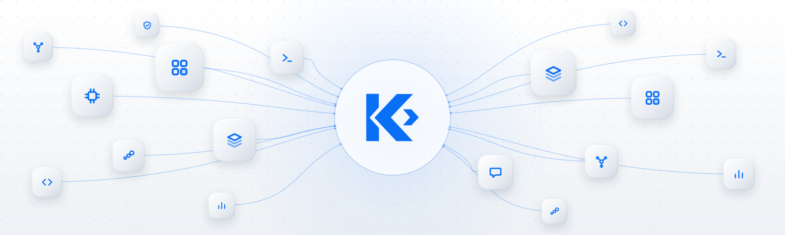
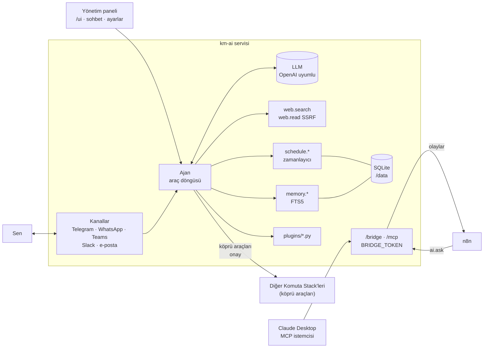

<div align="center">



<h1>
  
  km-ai
</h1>

**Projelerin için hazır bir AI altyapısı: model, araçlar, hafıza, zamanlayıcı, kanallar ve MCP köprüsü tek serviste.**
Bir **Komuta Stack**'i: tek `komuta.yaml` ile Komuta'da, birkaç komutla yerelde. Bu AI altyapısını kendi projelerine ve diğer Komuta Stack'lerine kolayca entegre edebilirsin.

[](https://komuta.io/tr/docs/stacks/stacks)
[](requirements.txt)
[](LICENSE)
[](docs/KOPRULER.md#mcp-istemcileri-claude-desktop-vb)
[](README.en.md)

</div>

---

## İçindekiler

- [Nedir](#nedir)
- [Neler yapar](#neler-yapar)
- [5 dakikada kur](#5-dakikada-kur)
- [Örnek sohbetler](#örnek-sohbetler)
- [Komutlar](#komutlar)
- [Seçenekler](#seçenekler)
- [Yönetim arayüzü](#yönetim-arayüzü)
- [Güvenlik](#güvenlik)
- [Geliştirici alanı](#geliştirici-alanı)
- [Köprüler](#köprüler)
- [SSS](#sss)
- [Bilinen sınırlar](#bilinen-sınırlar)
- [English](#english)
- [Kaynaklar](#kaynaklar)

## Nedir

km-ai, kendi projelerinin ve diğer Komuta Stack'lerinin üzerine oturan hazır bir **AI altyapısıdır**. Sıfırdan kurmak yerine tek servis olarak gelen parçalar: OpenAI uyumlu herhangi bir model (14 sağlayıcı, varsayılan OpenRouter) ve **araç çağırma**, web arama ve sayfa okuma, hafıza, zamanlanmış görevler, riskli işler için onay akışı, çok kanallı sohbet (Telegram, WhatsApp, Microsoft Teams, Slack, e-posta ve panelin kendi **Sohbet** sayfası: hangisinden yazarsan aynı AI, araç, hafıza ve zamanlayıcı çalışır) ve tüm araçları açan HTTP köprüsü ile **MCP** (n8n, başka stack'ler, Claude Desktop gibi istemciler). Kurulum ve yönetim, serviste yerleşik **yönetim panelinden** (`/ui`, Türkçe ve İngilizce) birkaç dakikada yapılır. Bir [Komuta Stack](https://komuta.io/tr/docs/stacks/stacks)'idir; [komuta-stack-kit](https://github.com/mustafazahter/komuta-stack-kit) üzerine kuruludur.

**Asıl amaç basit bir sohbet asistanı olmak değil, AI altyapısı kurma sürecini kolaylaştırmaktır.** Sohbet asistanı olarak da çalışır, ama değeri başka yerde: projenizin işlevlerini [komuta-stack-kit](https://github.com/mustafazahter/komuta-stack-kit) ile `@tool` olarak yazarsınız, HTTP köprüsü ve MCP ile km-ai'ye bağlarsınız; AI bunları her kanaldan kullanır, para ya da geri alınamaz işleri kullanıcı onayına bağlar. Aynı altyapıyı kendi projelerinize veya diğer Komuta Stack'lerinize kolayca entegre edebilirsiniz. Nasıl yapıldığı: [Örnek kullanım senaryosu](#örnek-kullanım-senaryosu-kendi-projeni-km-aiye-bağla).



## Neler yapar

| Özellik | Ayrıntı |
|---|---|
| **Çok kanallı sohbet** | Telegram, WhatsApp, Microsoft Teams, Slack ve e-posta; hepsi aynı AI, araç, hafıza ve zamanlayıcıyı paylaşır. Kanallar tek **Kanallar** sayfasında; her biri kendi sayfasına, kurulum rehberine, izin listesine ve sistem istemine sahiptir ([KANALLAR.md](docs/KANALLAR.md)) |
| **Web araması** | `web.search`, varsayılan **otomatik** mod: ücretsiz kanalları (anahtarsız Parallel, DuckDuckGo, açık SearXNG) sırayla dener, hata vereni atlar; Tavily / Brave / Serper / kendi SearXNG'n eklenirse öne geçer |
| **Sayfa okuma** | `web.read`: okunabilir metin; özel ağ/metadata adreslerine **SSRF koruması** |
| **Zamanlanmış görev** | Cron, "10 dakika sonra", ISO zaman; sabit mesaj ya da zamanı gelince AI'nın çalıştırdığı istem. Mesajlara varsayılan emoji eklenmez |
| **Hafıza** | AI neyi hatırlayacağına kendi karar verir; her mesajda ilgili anılar bağlama girer; `/hafiza` ile yönet |
| **Sistem istemi** | Genel istem her kanalda geçerlidir; kanal başına ek istem yazılır (önce genel, sonra kanalınki). AI kendi araç listesini bilir ve sorulunca eksiksiz anlatır |
| **Yönetim paneli** | Adım adım ilk kurulum sihirbazı, kurulum durum listesi, panelden **sohbet** (araçlar çalışır, onaylar tarayıcıda), canlı ayarlar, TR/EN, "nasıl yapılır" yardımları, yeni sürümde kendini yenileyen sekme |
| **Köprüler** | mt5-trader gibi stack'lerin araçları AI'ya açılır; para işlemleri **senin düğmene** bağlı |
| **MCP + HTTP** | Tüm araçlar `/mcp` ve `/bridge` üzerinden; n8n'den `ai.ask` ile soru |
| **Plugin** | `plugins/*.py` içine `@tool` yaz, AI hemen kullanır |

## 5 dakikada kur

> [!TIP]
> **Web araması** varsayılan olarak `auto` modunda çalışır ve anahtar istemez. Daha güvenilir sonuç için panelden bir anahtarlı sağlayıcı (Tavily, Brave, Serper) veya kendi SearXNG adresini ekleyebilirsin: [`examples/komuta-arama-saglayicili.yaml`](examples/komuta-arama-saglayicili.yaml).

### Yol A — Komuta (önerilen)

1. Bu repoyu **fork**'la. Komuta panelinde bir **proje** aç ve GitHub bağlantını kur ([hızlı başlangıç](https://komuta.io/tr/docs/getting-started/quick-start)).
2. `komuta.yaml` içinde `<proje-adi>`, `<git-baglanti-adi>`, `<kullanici>` yer tutucularını doldur.
3. `console.komuta.io/stacks/new` → **Kaynak** → **komuta.yaml** kutusuna dosyayı yapıştır → **Planı incele** ([Stacks belgesi](https://komuta.io/tr/docs/stacks/stacks), [komuta.yaml başvurusu](https://komuta.io/tr/docs/stacks/stack-manifest-reference)).
4. **Yayınla.** Zorunlu Secret yok. Varsayılan manifestte [otomatik dağıtım](https://komuta.io/tr/docs/services/service-auto-deploy) açıktır: depoya her `git push` servisi yeniden yayınlar; açık panel sekmesi yeni sürümü görünce kendini yeniler; eski sürüm yenisi hazır olana dek hizmet verir ([sıfır kesintili yayın](https://komuta.io/tr/blog/komuta-ekibi/zero-downtime-blue-green-deployment)).
5. Servisin **Loglar** sekmesinden `Kurulum kodu`nu al, `https://<servis-adresi>/ui/` aç (önce Komuta girişi), kodla panel parolasını belirle. Sihirbaz önce hangi kanaldan konuşacağını sorar (Telegram, WhatsApp, Teams, Slack, e-posta ya da yalnız panel) ve **seçtiğin kanalın kurulumuyla devam eder** (Telegram için token ve sohbet kimliği: [@BotFather](docs/KURULUM.md#1-telegram-bot-tokenı); WhatsApp, Teams, Slack, e-posta: [docs/KANALLAR.md](docs/KANALLAR.md)); sonra yapay zekâ sağlayıcısını ve aramayı sorar. Kanal bağlamadan da panelin **Sohbet** sayfasından hemen konuşabilirsin, diğer kanalları sonradan **Kanallar** sayfasından eklersin. Hepsini Secret/ortam değişkeniyle vermek istersen: [`examples/komuta-env-ile.yaml`](examples/komuta-env-ile.yaml); değişkenler için [Komuta ortam değişkenleri belgesi](https://komuta.io/tr/docs/services/services-environment-variables).

Konsolda URL ile ön-doldurma yoktur; manifest yapıştırılır. MCP ile kurulum ve ayrıntılar: [docs/KURULUM.md](docs/KURULUM.md). Komuta tarafı: [Stacks](https://komuta.io/tr/docs/stacks/stacks), [yeni servis rehberi](https://komuta.io/tr/docs/services/new-service-guide), [MCP kurulumu](https://komuta.io/tr/docs/mcp/mcp-setup).

### Yol B — Docker compose (yerel)

```bash
scripts/setup.sh            # tokenları sorar, .env üretir (UI_PASSWORD, BRIDGE_TOKEN dahil)
docker compose up --build
```

### Yol C — Python (geliştirme)

```bash
uv venv --python 3.12 && uv pip install -r requirements-dev.txt
scripts/setup.sh
PYTHONPATH=src:. .venv/bin/python -m ai_bot
```

Anahtarsız denemek istersen sahte LLM: `.venv/bin/python scripts/fake_llm.py 9999` ve `LLM_BASE_URL=http://127.0.0.1:9999/v1` ([adımlar](docs/KURULUM.md#6-python-ile-yerel-geliştirme)).

## Örnek sohbetler

Anlatım kolay olsun diye örnekler **Telegram üzerinden** gösterilir; aynı konuşmalar WhatsApp, Teams, Slack, e-posta ve panel sohbetinde de çalışır.

```text
Sen: Bu hafta sonu İzmir'de ne etkinlikler var?
Bot: (web_search → web_read) Üç etkinlik buldum: … Kaynaklar: https://…

Sen: Her sabah 9'da teknoloji haberlerini özetle.
Bot: (schedule_add, kind=prompt, cron "0 9 * * *") Tamam, her gün 09:00'da özet göndereceğim. #4

Sen: Adım Deniz, kahveyi sütsüz içerim.
Bot: (memory_remember ×2) Not aldım, Deniz.
     … iki gün sonra …
Sen: Bana bir kahve dükkânı önerir misin?
Bot: Sütsüz kahve sevdiğin için filtre kahvesiyle bilinen şu yerlere bakabilirsin: …

Sen: 20 dakika sonra fırını kapatmamı hatırlat.
Bot: (schedule_add) 20:42'de hatırlatacağım.
Fırını kapat!

Sen: 0.01 lot altın al.          (mt5-trader köprüsü bağlıysa)
Bot: AI bu işlemi yapmak istiyor: mt5.buy  {symbol: XAUUSD, lot: 0.01}
     [Onayla] [İptal]
```

Parantez içindekiler botun arkada kullandığı araçlardır; gerçek cevaplar modele göre değişir.

## Komutlar

Komutlar **her kanalda** çalışır: Telegram, WhatsApp, Microsoft Teams, Slack ve e-posta. `/komut` ya da `!komut` yazılır (Slack `/` ile başlayan mesajları kendi komutu sayar, orada `!hafiza` yaz). Komut olmayan metin AI'ya gider; komutlar AI'ya hiç uğramaz. Onay isteyen komutlar (`/hafiza temizle`) Telegram'da düğmeyle, diğer kanallarda `EVET 123456` koduyla onaylanır. E-postada gönderen doğrulanamadığı için yalnız okuma komutları çalışır (`/help`, argümansız `/hafiza` `/gorevler` `/model`); değiştirenler reddedilir.

| Komut | Ne yapar |
|---|---|
| `/start` | Karşılama (yalnız Telegram; izin listesinde değilsen kimliğini söyler) |
| `/help` | Kullanım ve örnekler |
| `/id` | Sohbet kimliği (yalnız Telegram; izin listesi boşken de çalışır) |
| `/hafiza` | Anıları listele · `/hafiza sil <no>` · `/hafiza temizle` |
| `/gorevler` | Zamanlanmış görevler · `/gorevler iptal <no>` |
| `/model` | Modeli gör · `/model <ad>` · `/model varsayilan` |
| `/sifirla` | Sohbet geçmişini temizle (anılar kalır) |

### Kendi komutunu ekle

`plugins/` altına bir dosya koy; komut tek kez yazılır, tüm kanallarda (ve Telegram'ın komut menüsünde) görünür, `/help` listeler:

```python
# plugins/ping.py
from ai_bot.commands import command

@command("ping", "Canlılık testi / liveness", readonly=True)
async def ping(ctx):
    kanal = ctx.channel.name if getattr(ctx, "channel", None) else "telegram"
    return f"pong ({kanal}) {ctx.arg_text}".strip()
```

`ctx`: `chat_id`, `args`, `arg_text`, `reply()`, `confirm()` (kullanıcı onayı), `run_tool()`. Hiçbir şeyi değiştirmeyen komuta `readonly=True` ver; öyle olmayan komut e-postada "bu kanalda kapalı" yanıtı alır. Silen ya da değiştiren komutta kullanıcıya `await ctx.confirm("... yapılsın mı?")` ile sor. Adım adım yönerge, test kalıbı ve kurallar: `.claude/skills/add-command/SKILL.md` ve [docs/GELISTIRICI.md](docs/GELISTIRICI.md#komut-ekleme-her-kanalda).

## Seçenekler

| Env | Varsayılan | Açıklama |
|---|---|---|
| `TELEGRAM_BOT_TOKEN` | — | Telegram kanalı için Secret `bot-token` |
| `TELEGRAM_ENABLED` | `true` | Telegram kanalını aç/kapat (panelde anahtar); kapalıyken bot mesaj dinlemez |
| `ALLOWED_CHAT_IDS` | — | Telegram izin listesi, Secret `allowed-chat-ids`; boşken yalnız `/id`, `/start` (diğer kanalların listeleri kendi sayfalarında) |
| `LLM_PROVIDER` | `auto` | Sağlayıcı (14 seçenek); `auto` adresten anlaşılır |
| `LLM_BASE_URL` | `https://openrouter.ai/api/v1` | OpenAI uyumlu uç |
| `LLM_API_KEY` | — | Secret `llm-api-key` |
| `LLM_MODEL` | `openai/gpt-4o-mini` | Model. **Önerilen: `deepseek/deepseek-v4.1-flash-1017`** (DeepSeek V4.1 flash, ucuz); sihirbaz bunu önerir. Yerleşik varsayılan, çalışan kurulumların modeli sessizce değişmesin diye aynı kaldı |
| `MAX_TOOL_STEPS` | 6 | Mesaj başına araç turu |
| `SEARCH_PROVIDER` | `auto` | `parallel` · `duckduckgo` · `tavily` · `brave` · `serper` · `searxng` |
| `TAVILY_API_KEY` · `BRAVE_API_KEY` · `SERPER_API_KEY` · `SEARXNG_URL` | — | Seçtiğin arama sağlayıcısının anahtarı/adresi (panelden de girilir) |
| `TZ` | `Europe/Istanbul` (manifest) | Zamanlayıcı saat dilimi |
| `BRIDGE_TOKEN` | panelden üretilir (n8n örneğinde Komuta da üretir) | `/bridge`, `/mcp` anahtarı |
| `BRIDGE_<AD>_URL` + `_TOKEN` | — | Başka stack'in araçları |
| `WHATSAPP_*` · `TEAMS_*` · `SLACK_*` · `EMAIL_*` | kapalı | Kanal ayarları ve sırları; panelde **Kanallar** sayfasından girilir ([docs/KANALLAR.md](docs/KANALLAR.md)) |
| `WEBHOOKS_OUT_URL` + `_SECRET` | — | Olayları n8n'e gönder |

Tam liste: [`.env.example`](.env.example), [docs/LLM-SAGLAYICILAR.md](docs/LLM-SAGLAYICILAR.md), [docs/ARACLAR.md](docs/ARACLAR.md).

Güncel fiyatlar: [Komuta fiyatlandırma](https://komuta.io/tr/pricing).

| Manifest | Ne | Aylık (yaklaşık) |
|---|---|---|
| [`komuta.yaml`](komuta.yaml) | Varsayılan, tek tık | `dz-dev` ~9 USD + disk `Small` + LLM kullanımı |
| [`examples/komuta-mt5-ile.yaml`](examples/komuta-mt5-ile.yaml) | mt5-trader köprüsü | + mt5-trader Stack'i |
| [`examples/komuta-n8n-ile.yaml`](examples/komuta-n8n-ile.yaml) | n8n olayları + `ai.ask` | aynı |
| [`examples/komuta-arama-saglayicili.yaml`](examples/komuta-arama-saglayicili.yaml) | Tavily araması | + Tavily planı |
| [`examples/komuta-env-ile.yaml`](examples/komuta-env-ile.yaml) | Bütün ayarlar Secret/ortamdan; değerler sihirbazda dolu gelir, doğrulama bekler | aynı |
| [`examples/komuta-giris-kapali.yaml`](examples/komuta-giris-kapali.yaml) | Komuta girişi yok, yalnız panel parolası (n8n/MCP/webhook için) | aynı |

## Yönetim arayüzü

Servis `/ui` adresinde sade bir yönetim paneli taşır (açık/koyu tema, mobil uyumlu, dış istek yok, Türkçe ve İngilizce):

- **İki kapı:** varsayılan `komuta.yaml` yalnız `/ui` yolunu Komuta girişinin arkasına alır ([erişim koruması](https://komuta.io/tr/docs/services/stack-manifest-access)); panelin kendi parolası da vardır. Sitenin geri kalanı (`/health`, `/bridge`, `/mcp`, `/hook`, `/channels`) girişsiz açıktır ve kendi korumasını taşır (token, HMAC imzası, JWT). İlk açılışta servis günlüğüne (Komuta konsolu → Loglar) tek kullanımlık **kurulum kodu** yazılır; `/ui/setup` kodla panel parolasını belirletir.
- **Kurulum sihirbazı ve durum listesi:** panel parolası, **kanal seçimi** (seçtiğin kanalın kurulumuyla devam edilir), yapay zekâ sağlayıcısı (OpenRouter, OpenAI, Anthropic (Claude), Gemini, xAI (Grok), Groq, DeepSeek, Mistral, Together, Perplexity, Ollama, LM Studio, vLLM, özel) + **otomatik model listesi ve fiyatlar**, arama. Ortam değişkenlerinden gelen değerler dolu görünür; doğrulanmadan "tamam" sayılmaz. **Kurulum** sayfası her adımın durumunu gösterir ve istediğin an düzenletir.
- **Genel bakış:** bot durumu, sayılar, web arama, köprü yüzeyleri ve son hatalar kompakt kartlarda. Sayfa her 10 saniyede yalnız değişen değerleri yerinde günceller (yeniden yükleme, titreme yok); tekrarlayan hatalar tek satırda "N kez" olarak gruplanır.
- **Sohbet:** panelden bota yaz, model seç, araçlar çalışsın; onay isteyen işlemler tarayıcıda sorulur. Konuşma yalnız o sekmede tutulur.
- **Kanallar:** Telegram, WhatsApp, Teams, Slack ve e-posta tek sayfada kompakt kartlar; her kanalın aç/kapat anahtarı, kendi sayfası, adım adım kurulum rehberi, izin listesi, test düğmesi ve kanala özel sistem istemi vardır. Telegram'ı açıp kapatabilirsin (kapalıyken bot mesaj dinlemez).
- **Ayarlar**, **Entegrasyonlar** (köprü/MCP/webhook varsayılan KAPALI; açınca token bir kez gösterilir; n8n, curl, Claude Code/Desktop, TradingView örnekleri), Hafıza, Görevler, Araçlar, Günlük.
- **Küçük ayrıntılar:** her parola ve sır alanında göster/gizle gözü; "Nasıl yapılır?" mini rehberleri; yeni sürüm yayınlanınca açık sekmenin kendiliğinden yenilenmesi; sunucu güncellenirken "Güncelleniyor" ekranı.

Öncelik: **panel > ortam değişkeni > varsayılan**; değişiklikler yeniden başlatmadan uygulanır. Sırlar yalnız yazılır (panel yalnız `…son4` gösterir). Güvenlik kilitleri panelden kapatılamaz. Ayrıntı: [docs/ARAYUZ.md](docs/ARAYUZ.md), kanallar: [docs/KANALLAR.md](docs/KANALLAR.md).

## Güvenlik

- **Repoda sır yok.** Tokenlar ve kişisel `ALLOWED_CHAT_IDS` Komuta Secret'ı; `.env` git dışında.
- **İzin listesi.** Her kanalın kendi izin listesi vardır (Telegram: `ALLOWED_CHAT_IDS`; diğerleri kanal sayfasında). Boş liste = kimse yazamaz; listede olmayan gönderenin serbest metni sessizce düşer (Telegram'da `/start` ve `/id` yine yanıt verir).
- **Onaysız para hareketi yok.** Onay isteyen veya `scope: trade/admin` olan her araç, kullanıcı onaylamadan çalışmaz: Telegram'da **Onayla** düğmesi, WhatsApp/Teams/Slack'te kodlu yanıt; e-postada ve panelde onaysız yol yoktur (e-posta reddeder, panel sohbeti tarayıcıda sorar). AI onayı kendisi veremez, `confirm_id`'yi hiç görmez. Testli: `tests/test_confirm_flow.py`.
- **SSRF koruması.** `web.read` yalnız herkese açık adreslere gider; DNS sonrası IP denetimi, IP sabitleme, her yönlendirmede yeniden denetim, boyut/süre sınırı. Testli: `tests/test_safefetch.py`.
- **İstem enjeksiyonuna karşı.** Bir turda web içeriği okunduysa aynı turdaki hafıza kaydı ve zamanlama kullanıcı onayı ister; anılar modele "VERİ, TALİMAT DEĞİL" işaretli blokta verilir; zamanlanmış görevler yeni görev kuramaz.
- **Liste dışı sohbet yok.** Köprü/MCP çağıranı yalnız `ALLOWED_CHAT_IDS` sohbetlerine yazdırabilir; liste boşsa sohbet araçları kapalıdır.
- **Root olmayan çalışma.** İmaj `USER 1000` ile çalışır, `/data` imajda 1000'e aittir; çalışma anında disk sahipliğine dokunulmaz (Komuta güncellemeleri için şart).
- **İki kapı, kapalı köprü.** Varsayılan manifestte yalnız `/ui` Komuta girişi ister ve ayrıca panel parolası vardır; `/bridge`, `/mcp`, `/hook` varsayılan kapalı (404) ve açılınca token/HMAC ister, kanal webhook'ları kendi imzasını doğrular. Komuta girişini tamamen kapatmak için `examples/komuta-giris-kapali.yaml` ([docs/GUVENLIK.md](docs/GUVENLIK.md)).
- **Panel parolalı.** İlk kurulum tek kullanımlık kodla; her yazma isteği CSRF korumalı; sırlar geri gösterilmez; koruma yalnız parola + onay ifadesiyle kapatılır. Testli: `tests/test_ui.py`, `tests/test_ui_v2.py`.

Ayrıntı ve ödünleşimler: [docs/GUVENLIK.md](docs/GUVENLIK.md).

## Geliştirici alanı

```python
# plugins/not_ekle.py — AI, /bridge ve /mcp hemen görür
from stack_kit import ToolError, tool

@tool("not.ekle", "Kısa bir not kaydeder / Saves a short note", scope="read")
def ekle(metin: str) -> dict:
    if len(metin) > 200:
        raise ToolError("not çok uzun", code="invalid_args")
    return {"kaydedildi": metin}
```

```bash
.venv/bin/python -m stack_kit tools      # plugin araçlarını listeler
.venv/bin/python -m pytest               # sahte LLM + sahte Telegram ile testler
```

- Örnekler: [`plugins/ornek_arac.py`](plugins/ornek_arac.py), gerçek örnek [`plugins/haber_ozet.py`](plugins/haber_ozet.py) (RSS başlıkları).
- Başka stack'e gömme: `ai_bot.setup(stack, bot)` → [docs/GELISTIRICI.md](docs/GELISTIRICI.md).
- Claude Code becerileri (`.claude/skills/`): `add-ai-tool`, `add-command`, `add-channel`, `add-search-provider`, `add-memory-policy`, `add-llm-provider`, `add-ui-page`, `configure-access` ve ortak `add-tool`, `add-hook`, `add-bridge`, `emit-event`, `add-mcp-client`, `deploy-to-komuta`, `validate-stack`.
- Ajan kuralları: [CLAUDE.md](CLAUDE.md) · [AGENTS.md](AGENTS.md).

### Örnek kullanım senaryosu: kendi projeni km-ai'ye bağla

Senaryo: küçük bir e-ticaret projen var. Müşteri "Siparişim nerede?" diye sorunca km-ai kargo bilgisini projenden çeksin; iade gibi riskli bir işlem yalnız senin onayınla yapılsın; kargo gecikince bir otomasyon tetiklensin. Hepsi [komuta-stack-kit](https://github.com/mustafazahter/komuta-stack-kit) ile tek dosyada yazılır ve çalışan hâli bu depoda: [`examples/ornek-stack/kargo_stack.py`](examples/ornek-stack/kargo_stack.py) (testli: `tests/test_example_stack.py`).

**1. Projene araç ekle.** `@tool` ile bir Python fonksiyonu araç olur; tip ipuçlarından şema çıkar. Geri alınamaz işlere `confirm=True` ve `scope="admin"` (ya da `"trade"`) ver: km-ai bunları kullanıcı onayı olmadan asla çalıştırmaz.

```python
from stack_kit import ToolError, configure, emit, hook, run, tool

configure(name="kargo", version="0.1.0", events=["kargo.gecikti"])

@tool("kargo.durum", "Sipariş numarasıyla kargo durumunu söyler")
def durum(siparis_no: str) -> dict:
    ...                                   # veritabanın ya da kargo firmasının API'si

@tool("kargo.iade_baslat", "Siparişi iade eder (onay ister)", confirm=True, scope="admin")
def iade_baslat(siparis_no: str, neden: str = "") -> dict:
    ...

@hook("kargo-guncelle")                   # kargo firmasının webhook'u
def kargo_guncelle(req):
    ...                                   # gecikmede: emit("kargo.gecikti", {...})

if __name__ == "__main__":
    run()
```

**2. Çalıştır.**

```bash
BRIDGE_TOKEN=kargo-token-change-me-0123456789 HTTP_HOST=127.0.0.1 HTTP_PORT=8081 \
  python examples/ornek-stack/kargo_stack.py
```

**3. km-ai'ye bağla.** km-ai tarafına iki ortam değişkeni yeter; araçlar açılışta keşfedilir ve `kargo_durum`, `kargo_iade_baslat` olarak modele görünür:

```bash
BRIDGE_KARGO_URL=http://127.0.0.1:8081
BRIDGE_KARGO_TOKEN=kargo-token-change-me-0123456789
```

Komuta'da iki ayrı Stack olarak: `BRIDGE_KARGO_URL` için `valueFrom.service`, `BRIDGE_KARGO_TOKEN` için Secret kullanılır, hedef servis `network.public: true` olmalıdır ([docs/KOPRULER.md](docs/KOPRULER.md#mt5-trader-ile) aynı kalıbı mt5-trader için anlatır).

**4. Kullan.** Hangi kanaldan olursa olsun (panel sohbeti, Telegram, WhatsApp, Teams, Slack):

```text
Sen: 1042 numaralı siparişim nerede?
Bot: (kargo_durum) Siparişin dağıtımda; Yurtiçi bugün 18:00'e kadar teslim etmeyi planlıyor.

Sen: 1042'yi iade et, ürün hasarlıymış.
Bot: AI bu işlemi yapmak istiyor: kargo.iade_baslat  {siparis_no: 1042, neden: hasarlı}
     [Onayla] [İptal]      (Telegram'da düğme; WhatsApp/Teams/Slack'te kodlu yanıt)
```

**5. Genişlet.**
- Gecikme olayı (`kargo.gecikti`) projenin `WEBHOOKS_OUT_URL` adresine imzalı gider: n8n'de müşteriye e-posta ya da km-ai'ye `ai.ask` ile özet yazdıran bir akış kur ([n8n ile](docs/KOPRULER.md#n8n-ile)).
- Aynı araçlar `POST /mcp` ile Claude Desktop gibi MCP istemcilerinde de görünür.
- Projen zaten Python ise köprü yerine tek süreçte birleştir: `ai_bot.setup(stack, bot)` ([docs/GELISTIRICI.md](docs/GELISTIRICI.md#başka-bir-stacke-gömme-ai_botsetup)).
- Yeni araç, köprü, kanal ya da arama sağlayıcısı eklemek için `.claude/skills/` altındaki Claude Code becerilerini kullan (`add-tool`, `add-command`, `add-bridge`, `add-hook`, `emit-event`, `add-search-provider`).

## Köprüler

MCP tarafı için Komuta'nın kendi belgeleri: [MCP kurulumu](https://komuta.io/tr/docs/mcp/mcp-setup), [MCP araçları](https://komuta.io/tr/docs/mcp/mcp-tools); blog: [Komuta MCP Server Nedir? Claude ile Deploy](https://komuta.io/tr/blog/cahit-yusuf-kafadar/komuta-mcp-server).

| Bağlantı | Nasıl | Belge |
|---|---|---|
| mt5-trader (ayrı Stack) | `BRIDGE_MT5_URL` (`valueFrom.service.stack`) + `BRIDGE_MT5_TOKEN`; hedef servis public olmalı | [KOPRULER.md](docs/KOPRULER.md#mt5-trader-ile) |
| mt5-trader (tek servis) | mt5-trader içinden `ai_bot.setup(stack, bot)` | [GELISTIRICI.md](docs/GELISTIRICI.md) |
| n8n | Olaylar `WEBHOOKS_OUT_*` ile; n8n'den `POST /bridge/call/ai.ask` | [KOPRULER.md](docs/KOPRULER.md#n8n-ile) |
| MCP (Claude Desktop vb.) | `POST /mcp` + Bearer token | [KOPRULER.md](docs/KOPRULER.md#mcp-istemcileri-claude-desktop-vb) |

## SSS

<details><summary><b>Hangi modeli kullanmalıyım?</b></summary>

Araç çağırmayı destekleyen herhangi biri. Önerilen `deepseek/deepseek-v4.1-flash-1017` (OpenRouter, DeepSeek V4.1 flash): araç çağırır, 1M bağlam; 23 Kasım 2026'da OpenRouter'da milyon token başına yaklaşık 0,03 USD girdi / 0,20 USD çıktı (güncel fiyat için OpenRouter'a bak). Kurulum sihirbazı bu modeli önerir. Hep en yeni flash sürümü için `~deepseek/deepseek-flash-latest`; daha güçlüsü için `deepseek/deepseek-v4-pro`; yerel Ollama da olur. [LLM-SAGLAYICILAR.md](docs/LLM-SAGLAYICILAR.md)
</details>

<details><summary><b>Web araması sonuç vermiyor.</b></summary>

Anahtarsız DuckDuckGo bazı ağlardan otomatik istekleri reddeder. `SEARCH_PROVIDER=tavily` kullan: [`examples/komuta-arama-saglayicili.yaml`](examples/komuta-arama-saglayicili.yaml).
</details>

<details><summary><b>AI benim yerime işlem açabilir mi?</b></summary>

Yalnız sen düğmeye basarsan. Bkz. [Güvenlik](#güvenlik).
</details>

<details><summary><b>Verilerim nerede?</b></summary>

Servisin `/data` diskindeki SQLite dosyasında. Mesajlar seçtiğin LLM sağlayıcısına gider. `/sifirla`, `/hafiza temizle` ile silersin.
</details>

Daha fazlası: [docs/SSS.md](docs/SSS.md).

## Bilinen sınırlar

- **Docker imajı yerelde build edilerek denenmedi**; Komuta'da derlenip yayınlanıyor. Python testleri (pytest) ve gerçek uvicorn ile `/health`, `/bridge`, `/mcp` doğrulaması sahte LLM ile yapıldı.
- **Gerçek LLM ve gerçek Telegram ile geniş canlı deneme yapılmadı**; ikisi de testlerde sahte sunucularla (`tests/fakes.py`) taklit edilir. Telegram aç/kapa anahtarı yalnız sahte Telegram'la test edildi.
- **WhatsApp, Teams, Slack ve e-posta kanalları gerçek servislerle denenmedi**; imza, izin listesi ve onay akışı testlerle, sahte sağlayıcılarla doğrulandı.
- **Yayınlanan panel Komuta'da çalışıyor** (yalnız `/ui` Komuta girişli); canlı yayın akışı ve her yeni sürümün otomatik yenilemesi sahada sınanmaya devam ediyor.
- **Arama `auto` modunda en iyi çabadır**; anahtarsız kanallar bazı ağlardan bot korumasına takılabilir, bot bunu açık bir hata olarak bildirir ve anahtarlı sağlayıcı önerir.
- `/start` metni kit'in yerleşiğidir (izin listesi boşken de çalışması için).
- `scripts/entrypoint.sh` (yalnız yazılabilirlik uyarısı) ve Dockerfile kuralları yerel simülasyonla test edildi; imaj build edilmedi.
- Sır süzgeci kasıtlı olarak katıdır: "şifre yöneticisi kullanıyor" gibi masum cümleleri de reddedebilir.

## English

**km-ai** is a ready-made AI foundation, not just a chat assistant: one service that brings any OpenAI-compatible model with tool calling, web search, memory, a scheduler, an approval flow for risky actions, chat through Telegram, WhatsApp, Microsoft Teams, Slack, e-mail or the panel's own Chat page, and an HTTP bridge plus MCP that expose every tool. Its purpose is to make setting up AI infrastructure easy. It is a [Komuta Stack](https://komuta.io/docs/stacks/stacks): one `komuta.yaml` deploys it, and a built-in admin panel (`/ui`, Turkish and English) handles setup, channels and settings. The setup wizard asks which channel you want and continues with that channel's setup. Recommended model: `deepseek/deepseek-v4.1-flash-1017` (OpenRouter).

Most importantly, you can plug this AI foundation into your own projects or other Komuta Stacks with little effort (see the example scenario in [README.en.md](README.en.md#example-scenario-connect-your-own-project-to-km-ai)).

Full English documentation: [README.en.md](README.en.md). Komuta docs and blog: [komuta.io/docs](https://komuta.io/docs), [komuta.io/blog](https://komuta.io/blog).

## Kaynaklar

Komuta'nın kendi belgeleri ve yazıları:

- [Komuta nedir?](https://komuta.io/tr/docs/getting-started/concepts) · [Hızlı başlangıç](https://komuta.io/tr/docs/getting-started/quick-start) · [Tüm belgeler](https://komuta.io/tr/docs)
- Stack'ler: [Stacks](https://komuta.io/tr/docs/stacks/stacks) · [komuta.yaml başvurusu](https://komuta.io/tr/docs/stacks/stack-manifest-reference) · [Manifestte erişim koruması](https://komuta.io/tr/docs/services/stack-manifest-access)
- Servis: [Yeni servis rehberi](https://komuta.io/tr/docs/services/new-service-guide) · [Otomatik dağıtım](https://komuta.io/tr/docs/services/service-auto-deploy) · [Ortam değişkenleri](https://komuta.io/tr/docs/services/services-environment-variables)
- MCP: [MCP kurulumu](https://komuta.io/tr/docs/mcp/mcp-setup) · [MCP araçları](https://komuta.io/tr/docs/mcp/mcp-tools)
- Blog: [Komuta blogu](https://komuta.io/tr/blog) · [Komuta MCP Server Nedir? Claude ile Deploy](https://komuta.io/tr/blog/cahit-yusuf-kafadar/komuta-mcp-server) · [Sıfır Kesinti ile Mavi-Yeşil Dağıtım](https://komuta.io/tr/blog/komuta-ekibi/zero-downtime-blue-green-deployment) · [Komuta Nedir? Koddan Canlıya Bulut Platformu](https://komuta.io/tr/blog/cahit-yusuf-kafadar/what-is-komuta)
- Hesap: [Fiyatlandırma](https://komuta.io/tr/pricing) · [Faturalama ve cüzdan](https://komuta.io/tr/docs/account/billing)

<div align="center">

<br><br>

MIT · [komuta-stack-kit](https://github.com/mustafazahter/komuta-stack-kit) üzerinde · Katkılar hoş gelir

</div>
