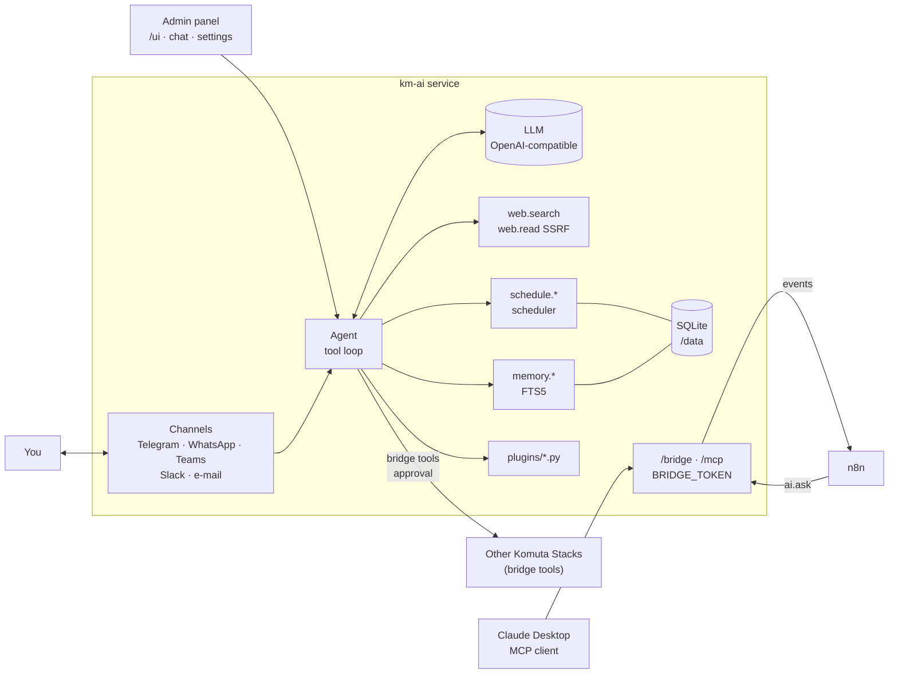

<div align="center">


<h1>
  
  km-ai
</h1>

**A ready-made AI foundation for your projects: model, tools, memory, scheduler, channels and an MCP bridge in one service.**
A **Komuta Stack**: one `komuta.yaml` on Komuta, a few commands locally. You can plug this AI foundation into your own projects and other Komuta Stacks with little effort.

[](https://komuta.io/docs/stacks/stacks)
[](requirements.txt)
[](LICENSE)
[](docs/BRIDGES.md#mcp-clients-claude-desktop-etc)
[](README.tr.md)

</div>

---

## Contents

- [What it is](#what-it-is)
- [Features](#features)
- [Install in 5 minutes](#install-in-5-minutes)
- [Example chats](#example-chats)
- [Commands](#commands)
- [Options](#options)
- [Admin UI](#admin-ui)
- [Security](#security)
- [Developer area](#developer-area)
- [Bridges](#bridges)
- [FAQ](#faq)
- [Known limits](#known-limits)
- [Resources](#resources)

Detailed docs are in [`docs/`](docs/) (English); the Turkish translations are in [`docs/tr/`](docs/tr/), and the Turkish README is [`README.tr.md`](README.tr.md).

## What it is

km-ai is a ready-made **AI foundation** that sits under your own projects and other Komuta Stacks. Instead of building it from scratch, one service brings: any OpenAI-compatible model (14 providers, OpenRouter by default) with **tool calling**, web search and page reading, memory, scheduled jobs, an approval flow for risky actions, multi-channel chat (Telegram, WhatsApp, Microsoft Teams, Slack, e-mail and the panel's own **Chat** page: whichever you write from, the same AI, tools, memory and scheduler answer), and an HTTP bridge plus **MCP** that expose all tools (n8n, other stacks, clients such as Claude Desktop). Setup and management take a few minutes in the built-in **admin panel** (`/ui`, Turkish and English). It is a [Komuta Stack](https://komuta.io/docs/stacks/stacks), built on [komuta-stack-kit](https://github.com/mustafazahter/komuta-stack-kit).

**The point is not to be a simple chat assistant, it is to make setting up AI infrastructure easy.** It works as a chat assistant too, but the value is elsewhere: you write your project's functions as `@tool`s with [komuta-stack-kit](https://github.com/mustafazahter/komuta-stack-kit) and connect them to km-ai over the HTTP bridge and MCP; the AI uses them from every channel, and money-moving or irreversible actions stay behind the user's approval. You can plug the same foundation into your own projects or other Komuta Stacks with little effort. How it works: [Example scenario](#example-scenario-connect-your-own-project-to-km-ai).



## Features

| Feature | Details |
|---|---|
| **Multi-channel chat** | Telegram, WhatsApp, Microsoft Teams, Slack and e-mail share the same AI, tools, memory and scheduler. One **Channels** page; each channel has its own page, setup guide, allow-list and system prompt ([docs/CHANNELS.md](docs/CHANNELS.md)) |
| **Web search** | `web.search`, default **auto** mode: tries the free channels (keyless Parallel, DuckDuckGo, public SearXNG) in turn and skips the ones that fail; Tavily / Brave / Serper / your own SearXNG take priority when set |
| **Page reading** | `web.read`: readable text with **SSRF protection** against private/metadata addresses |
| **Scheduled jobs** | Cron, "in 10 minutes", ISO time; a fixed message or a prompt the AI runs when due. Messages get no default emoji |
| **Memory** | The AI decides what to remember; relevant memories join every message; manage with `/hafiza` |
| **System prompt** | A general prompt applies to every channel; add a per-channel one on top (general first, then the channel's). The AI knows its real tool list and describes all of it when asked |
| **Admin panel** | Step-by-step first-run wizard, setup checklist, **chat** from the panel (tools run, confirmations in the browser), live settings, TR/EN, how-to guides, a tab that reloads itself on a new version |
| **Bridges** | Tools of stacks such as mt5-trader become AI tools; money moves only after **your button press** |
| **MCP + HTTP** | All tools on `/mcp` and `/bridge`; ask the AI from n8n with `ai.ask` |
| **Plugins** | Write a `@tool` in `plugins/*.py`, the AI uses it right away |

## Install in 5 minutes

> [!TIP]
> **Web search** runs in `auto` mode by default and needs no key. For more reliable results add a keyed provider (Tavily, Brave, Serper) or your own SearXNG address in the panel: [`examples/komuta-arama-saglayicili.yaml`](examples/komuta-arama-saglayicili.yaml).

### Path A — Komuta (recommended)

1. **Fork** this repo. Create a **project** in the Komuta console and connect GitHub ([quick start](https://komuta.io/docs/getting-started/quick-start)).
2. Fill the placeholders `<proje-adi>` (project), `<git-baglanti-adi>` (git connection), `<kullanici>` (GitHub user) in `komuta.yaml`.
3. `console.komuta.io/stacks/new` → **Kaynak** (Source) → paste into the **komuta.yaml** box → **Planı incele** (review plan) ([Stacks docs](https://komuta.io/docs/stacks/stacks), [komuta.yaml reference](https://komuta.io/docs/stacks/stack-manifest-reference)).
4. **Yayınla** (publish). No required Secrets. [Auto deploy](https://komuta.io/docs/services/service-auto-deploy) is on in the default manifest, so every `git push` redeploys the service; an open panel tab reloads itself on the new version while the old one keeps serving until the new one is ready ([zero-downtime rollouts](https://komuta.io/blog/komuta-ekibi/zero-downtime-blue-green-deployment)).
5. Take the `Kurulum kodu` (setup code) from the service's **Logs** tab, open `https://<service-address>/ui/` (Komuta sign-in first) and set the panel password with it. The wizard first asks which channel you will talk through (Telegram, WhatsApp, Teams, Slack, e-mail or panel only) and **continues with the setup of the channel you pick** (Telegram needs a token and chat id: [@BotFather](docs/SETUP.md#1-telegram-bot-token); WhatsApp, Teams, Slack, e-mail: [docs/CHANNELS.md](docs/CHANNELS.md)); then it asks for the AI provider and search. You can talk to it right away from the panel's **Chat** page without any channel, and add the other channels later from the **Channels** page. To pass everything as Secrets/environment instead: [`examples/komuta-env-ile.yaml`](examples/komuta-env-ile.yaml); variables: [Komuta environment variables docs](https://komuta.io/docs/services/services-environment-variables).

The console has no URL prefill; you paste the manifest. Installation with MCP and details: [docs/SETUP.md](docs/SETUP.md). On the Komuta side: [Stacks](https://komuta.io/docs/stacks/stacks), [new service guide](https://komuta.io/docs/services/new-service-guide), [MCP setup](https://komuta.io/docs/mcp/mcp-setup).

### Path B — Docker compose (local)

```bash
scripts/setup.sh            # asks for tokens, writes .env (UI_PASSWORD, BRIDGE_TOKEN included)
docker compose up --build
```

### Path C — Python (development)

```bash
uv venv --python 3.12 && uv pip install -r requirements-dev.txt
scripts/setup.sh
PYTHONPATH=src:. .venv/bin/python -m ai_bot
```

No key yet? Use the fake LLM: `.venv/bin/python scripts/fake_llm.py 9999` with `LLM_BASE_URL=http://127.0.0.1:9999/v1` ([steps](docs/SETUP.md#6-local-with-python-development)).

## Example chats

The examples are shown **through Telegram** to keep them easy to follow; the same conversations work in WhatsApp, Teams, Slack, e-mail and the panel chat.

```text
You: What's on in Izmir this weekend?
Bot: (web_search → web_read) I found three events: … Sources: https://…

You: Summarize tech news every morning at 9.
Bot: (schedule_add, kind=prompt, cron "0 9 * * *") Done, a summary every day at 09:00. #4

You: My name is Deniz, I drink my coffee black.
Bot: (memory_remember ×2) Noted, Deniz.

You: Remind me to turn off the oven in 20 minutes.
Bot: (schedule_add) I'll remind you at 20:42.
Turn off the oven!

You: Buy 0.01 lot gold.          (with the mt5-trader bridge)
Bot: The AI wants to run: mt5.buy  {symbol: XAUUSD, lot: 0.01}
     [Confirm] [Cancel]
```

Text in parentheses shows the tools used behind the scenes; real answers depend on the model.

## Commands

Commands work on **every channel**: Telegram, WhatsApp, Microsoft Teams, Slack and e-mail. Type `/command` or `!command` (Slack treats messages that start with `/` as its own commands, so type `!hafiza` there). Text that is not a command goes to the AI; commands never reach the AI. Commands that ask for approval (`/hafiza temizle`) are confirmed with a button in Telegram and with a code like `EVET 123456` elsewhere. On e-mail the sender cannot be verified, so only read-only commands run (`/help`, and `/hafiza`, `/gorevler`, `/model` without arguments); anything that changes something is refused.

| Command | What it does |
|---|---|
| `/start` | Welcome (Telegram only; tells unauthorized chats their id) |
| `/help` | Usage and examples |
| `/id` | Chat id (Telegram only; works even with an empty allow-list) |
| `/hafiza` | Memories · `/hafiza sil <n>` delete · `/hafiza temizle` clear all |
| `/gorevler` | Scheduled jobs · `/gorevler iptal <n>` cancel |
| `/model` | Show model · `/model <name>` · `/model varsayilan` (default) |
| `/sifirla` | Clear chat history (memories stay) |

### Add your own command

Drop a file into `plugins/`; a command is written once and shows up on every channel (and in Telegram's command menu), and `/help` lists it:

```python
# plugins/ping.py
from ai_bot.commands import command

@command("ping", "Liveness test", readonly=True)
async def ping(ctx):
    channel = ctx.channel.name if getattr(ctx, "channel", None) else "telegram"
    return f"pong ({channel}) {ctx.arg_text}".strip()
```

`ctx`: `chat_id`, `args`, `arg_text`, `reply()`, `confirm()` (user approval), `run_tool()`. Give `readonly=True` to a command that changes nothing; any other command gets "disabled on this channel" on e-mail. For commands that delete or change something, ask the user with `await ctx.confirm("... go ahead?")`. Step-by-step guide, test pattern and rules: `.claude/skills/add-command/SKILL.md` and [docs/DEVELOPER.md](docs/DEVELOPER.md#adding-a-command-on-every-channel).

## Options

| Env | Default | Description |
|---|---|---|
| `TELEGRAM_BOT_TOKEN` | — | Secret `bot-token` for the Telegram channel |
| `TELEGRAM_ENABLED` | `true` | Switch the Telegram channel on/off (a switch in the panel); off = the bot does not listen |
| `ALLOWED_CHAT_IDS` | — | Telegram allow-list, Secret `allowed-chat-ids`; empty = only `/id`, `/start` (the other channels keep their lists on their own pages) |
| `LLM_PROVIDER` | `auto` | Provider (14 options); `auto` is inferred from the address |
| `LLM_BASE_URL` | `https://openrouter.ai/api/v1` | OpenAI-compatible endpoint |
| `LLM_API_KEY` | — | Secret `llm-api-key` |
| `LLM_MODEL` | `openai/gpt-4o-mini` | Model. **Recommended: `deepseek/deepseek-v4.1-flash-1017`** (DeepSeek V4.1 flash, cheap); the wizard suggests it. The built-in default stayed the same so running installs do not change model silently |
| `MAX_TOOL_STEPS` | 6 | Tool rounds per message |
| `SEARCH_PROVIDER` | `auto` | `parallel` · `duckduckgo` · `tavily` · `brave` · `serper` · `searxng` |
| `TAVILY_API_KEY` · `BRAVE_API_KEY` · `SERPER_API_KEY` · `SEARXNG_URL` | — | Key/address of the search provider you picked (also set in the panel) |
| `TZ` | `Europe/Istanbul` (manifest) | Scheduler time zone |
| `BRIDGE_TOKEN` | generated in the panel (the n8n example lets Komuta generate it too) | Key for `/bridge`, `/mcp` |
| `BRIDGE_<NAME>_URL` + `_TOKEN` | — | Another stack's tools |
| `WHATSAPP_*` · `TEAMS_*` · `SLACK_*` · `EMAIL_*` | off | Channel settings and secrets; entered on the panel's **Channels** page ([docs/CHANNELS.md](docs/CHANNELS.md)) |
| `WEBHOOKS_OUT_URL` + `_SECRET` | — | Send events to n8n |

Full list: [`.env.example`](.env.example), [docs/LLM-PROVIDERS.md](docs/LLM-PROVIDERS.md), [docs/TOOLS.md](docs/TOOLS.md). Optional manifests: [`examples/`](examples/) (mt5-trader bridge, n8n, Tavily search). Default package `dz-dev` (~9 USD/month) + `Small` disk + your LLM usage.

Current prices: [Komuta pricing](https://komuta.io/pricing).

| Manifest | What | Monthly (approx.) |
|---|---|---|
| [`komuta.yaml`](komuta.yaml) | Default, one click | `dz-dev` ~9 USD + `Small` disk + LLM usage |
| [`examples/komuta-mt5-ile.yaml`](examples/komuta-mt5-ile.yaml) | mt5-trader bridge | + the mt5-trader Stack |
| [`examples/komuta-n8n-ile.yaml`](examples/komuta-n8n-ile.yaml) | n8n events + `ai.ask` | same |
| [`examples/komuta-arama-saglayicili.yaml`](examples/komuta-arama-saglayicili.yaml) | Tavily search | + a Tavily plan |
| [`examples/komuta-env-ile.yaml`](examples/komuta-env-ile.yaml) | Every setting from Secrets/environment; values show up filled in the wizard and wait for verification | same |
| [`examples/komuta-giris-kapali.yaml`](examples/komuta-giris-kapali.yaml) | No Komuta sign-in, panel password only (for n8n/MCP/webhooks) | same |

## Admin UI

The service ships a small admin panel at `/ui` (light/dark, mobile friendly, no external requests, Turkish and English):

- **Two gates:** the default `komuta.yaml` puts only `/ui` behind Komuta sign-in ([access protection](https://komuta.io/docs/services/stack-manifest-access)), and the panel has its own password. The rest of the site (`/health`, `/bridge`, `/mcp`, `/hook`, `/channels`) is open and carries its own protection (token, HMAC signature, JWT). On first start a one-time **setup code** is written to the service log (Komuta console → Logs); `/ui/setup` uses it to set the panel password. Forgot the password? Press **Forgot my password** on the sign-in page (`/ui/reset`): a one-time code valid for 15 minutes is written to the service log, and saving the new password closes all old sessions.
- **Setup wizard and checklist:** panel password, **channel choice** (setup continues with the channel you pick), LLM provider (OpenRouter, OpenAI, Anthropic (Claude), Gemini, xAI (Grok), Groq, DeepSeek, Mistral, Together, Perplexity, Ollama, LM Studio, vLLM, custom) with an **automatic model list and prices**, search. Values from environment variables show as filled but are not counted done until verified. The **Setup** page shows every step's state and lets you edit it any time.
- **Overview:** bot status, counts, web search, bridge surfaces and recent errors in compact cards. Every 10 seconds only the changed values are updated in place (no reload, no flicker); repeated errors are grouped on one line as "N times".
- **Chat:** write to the bot from the panel, pick a model, tools run; actions that need approval are asked in the browser. Conversations are stored on the server (plain text, secrets masked); reopen a past chat from the **History** list and delete them one by one or all at once.
- **Channels:** Telegram, WhatsApp, Teams, Slack and e-mail as compact cards on one page; each channel has an on/off switch, its own page, a step-by-step setup guide, an allow-list, a test button and its own system prompt. You can switch Telegram off (the bot then does not listen).
- **Settings**, **Integrations** (bridge/MCP/webhook closed by default; tokens shown once; n8n, curl, Claude Code/Desktop, TradingView examples), Memory, Tasks, Tools, Log.
- **Details:** a show/hide eye on every password and secret field; "How to?" mini guides; the open tab reloads itself when a new version is deployed; an "Updating" screen while the server rolls over.

Precedence: **panel > env var > default**; changes apply without a restart. Secrets are write-only (the panel shows `…last4` only). Security locks cannot be switched off from the panel. Details: [docs/ADMIN-UI.md](docs/ADMIN-UI.md), channels: [docs/CHANNELS.md](docs/CHANNELS.md).

## Security

- **No secrets in the repo.** Tokens and the personal `ALLOWED_CHAT_IDS` are Komuta Secrets; `.env` is git-ignored.
- **Allow-list.** Every channel has its own allow-list (Telegram: `ALLOWED_CHAT_IDS`; the others on their channel page). An empty list means nobody can write; free text from a sender who is not listed is dropped silently (in Telegram `/start` and `/id` still answer).
- **No money moves without approval.** Every tool that asks for confirmation or has `scope: trade/admin` does not run until the user approves: a **Confirm** button in Telegram, a coded reply in WhatsApp/Teams/Slack; e-mail and the panel have no unapproved path (e-mail refuses, the panel chat asks in the browser). The AI cannot approve itself and never sees the `confirm_id`. Tested: `tests/test_confirm_flow.py`.
- **SSRF protection.** `web.read` only reaches public addresses: IP check after DNS, connection pinned to the checked IP, every redirect re-checked, size/time limits. Tested in `tests/test_safefetch.py`.
- **Prompt-injection guard.** After outside web content was read in a turn, memory writes and schedules in that turn need the user's approval (Telegram button or channel code) and are rejected when no approval channel exists; memories reach the model in a block marked "DATA, NOT INSTRUCTIONS"; scheduled turns cannot create schedules.
- **No foreign chats.** Bridge/MCP callers can only target `ALLOWED_CHAT_IDS`; an empty list disables chat-scoped tools.
- **Non-root runtime.** The image runs as `USER 1000` and `/data` is owned by 1000 in the image; disk ownership is never changed at runtime (required for Komuta updates).
- **Two gates, closed bridge.** In the default manifest only `/ui` asks for Komuta sign-in, and the panel has its own password; `/bridge`, `/mcp`, `/hook` are closed (404) by default and token/HMAC protected when opened; channel webhooks verify their own signatures. To drop Komuta sign-in entirely use `examples/komuta-giris-kapali.yaml` ([docs/SECURITY.md](docs/SECURITY.md)).
- **Password-protected panel.** First-time setup with a one-time code (a forgotten password is reset the same way, with a one-time code from the log); every write is CSRF protected; secrets are never shown back; protection can only be switched off with the password and a confirmation phrase. Tested in `tests/test_ui.py`, `tests/test_ui_v2.py`.

Details and trade-offs: [docs/SECURITY.md](docs/SECURITY.md).

## Developer area

```python
# plugins/not_ekle.py — the AI, /bridge and /mcp see it immediately
from stack_kit import ToolError, tool

@tool("not.ekle", "Kısa bir not kaydeder / Saves a short note", scope="read")
def ekle(metin: str) -> dict:
    if len(metin) > 200:
        raise ToolError("not çok uzun", code="invalid_args")
    return {"kaydedildi": metin}
```

```bash
.venv/bin/python -m stack_kit tools      # list plugin tools
.venv/bin/python -m pytest               # tests with fake LLM + fake Telegram
```

- Examples: [`plugins/ornek_arac.py`](plugins/ornek_arac.py), real-world [`plugins/haber_ozet.py`](plugins/haber_ozet.py) (RSS headlines).
- Embed into another stack: `ai_bot.setup(stack, bot)` → [docs/DEVELOPER.md](docs/DEVELOPER.md).
- Claude Code skills in `.claude/skills/`: `add-ai-tool`, `add-command`, `add-channel`, `add-search-provider`, `add-memory-policy`, `add-llm-provider`, `add-ui-page`, `configure-access` plus the shared kit skills `add-tool`, `add-hook`, `add-bridge`, `emit-event`, `add-mcp-client`, `deploy-to-komuta`, `validate-stack`.
- Agent rules: [CLAUDE.md](CLAUDE.md) · [AGENTS.md](AGENTS.md).

### Example scenario: connect your own project to km-ai

Scenario: you run a small e-commerce project. When a customer asks "Where is my order?", km-ai should pull the parcel status from your project; a risky action such as a return must only happen with your approval; and a late parcel should trigger an automation. All of it is written in one file with [komuta-stack-kit](https://github.com/mustafazahter/komuta-stack-kit), and the working version lives in this repo: [`examples/ornek-stack/kargo_stack.py`](examples/ornek-stack/kargo_stack.py) (tested in `tests/test_example_stack.py`).

**1. Add tools to your project.** `@tool` turns a Python function into a tool; the schema comes from the type hints. Give irreversible actions `confirm=True` and `scope="admin"` (or `"trade"`): km-ai never runs them without the user's approval.

```python
from stack_kit import ToolError, configure, emit, hook, run, tool

configure(name="kargo", version="0.1.0", events=["kargo.gecikti"])

@tool("kargo.durum", "Tells the parcel status of an order")
def durum(siparis_no: str) -> dict:
    ...                                   # your database or the carrier's API

@tool("kargo.iade_baslat", "Starts a return (needs approval)", confirm=True, scope="admin")
def iade_baslat(siparis_no: str, neden: str = "") -> dict:
    ...

@hook("kargo-guncelle")                   # the carrier's webhook
def kargo_guncelle(req):
    ...                                   # when late: emit("kargo.gecikti", {...})

if __name__ == "__main__":
    run()
```

**2. Run it.**

```bash
BRIDGE_TOKEN=kargo-token-change-me-0123456789 HTTP_HOST=127.0.0.1 HTTP_PORT=8081 \
  python examples/ornek-stack/kargo_stack.py
```

**3. Connect it to km-ai.** Two environment variables on the km-ai side are enough; the tools are discovered at startup and show up to the model as `kargo_durum` and `kargo_iade_baslat`:

```bash
BRIDGE_KARGO_URL=http://127.0.0.1:8081
BRIDGE_KARGO_TOKEN=kargo-token-change-me-0123456789
```

On Komuta as two separate Stacks: use `valueFrom.service` for `BRIDGE_KARGO_URL` and a Secret for `BRIDGE_KARGO_TOKEN`; the target service must be `network.public: true` ([docs/BRIDGES.md](docs/BRIDGES.md#with-mt5-trader) shows the same pattern for mt5-trader).

**4. Use it.** From any channel (panel chat, Telegram, WhatsApp, Teams, Slack):

```text
You: Where is my order 1042?
Bot: (kargo_durum) It is out for delivery; the carrier plans to deliver it by 18:00 today.

You: Return order 1042, the item arrived damaged.
Bot: The AI wants to run: kargo.iade_baslat  {siparis_no: 1042, neden: damaged}
     [Confirm] [Cancel]    (a button in Telegram; a coded reply in WhatsApp/Teams/Slack)
```

**5. Extend it.**
- The late-parcel event (`kargo.gecikti`) is sent signed to your project's `WEBHOOKS_OUT_URL`: build an n8n flow that e-mails the customer or asks km-ai for a summary through `ai.ask` ([with n8n](docs/BRIDGES.md#with-n8n)).
- The same tools also appear to MCP clients such as Claude Desktop through `POST /mcp`.
- If your project is Python already, merge instead of bridging: `ai_bot.setup(stack, bot)` ([docs/DEVELOPER.md](docs/DEVELOPER.md#embedding-in-another-stack-ai_botsetup)).
- To add a tool, bridge, channel or search provider, use the Claude Code skills under `.claude/skills/` (`add-tool`, `add-command`, `add-bridge`, `add-hook`, `emit-event`, `add-search-provider`).

## Bridges

For the MCP side see Komuta's own docs: [MCP setup](https://komuta.io/docs/mcp/mcp-setup), [MCP tools](https://komuta.io/docs/mcp/mcp-tools); blog: [Komuta MCP Server: Deploy Apps with AI](https://komuta.io/blog/cahit-yusuf-kafadar/komuta-mcp-server).

| Link | How | Docs |
|---|---|---|
| mt5-trader (separate Stack) | `BRIDGE_MT5_URL` (`valueFrom.service.stack`) + `BRIDGE_MT5_TOKEN`; target service must be public | [BRIDGES.md](docs/BRIDGES.md#with-mt5-trader) |
| mt5-trader (one service) | `ai_bot.setup(stack, bot)` inside mt5-trader | [DEVELOPER.md](docs/DEVELOPER.md) |
| n8n | events via `WEBHOOKS_OUT_*`; `POST /bridge/call/ai.ask` from n8n | [BRIDGES.md](docs/BRIDGES.md#with-n8n) |
| MCP (Claude Desktop…) | `POST /mcp` + Bearer token | [BRIDGES.md](docs/BRIDGES.md#mcp-clients-claude-desktop-etc) |

## FAQ

<details><summary><b>Which model?</b></summary>

Any model with tool calling. Recommended: `deepseek/deepseek-v4.1-flash-1017` via OpenRouter (DeepSeek V4.1 flash: tool calling, 1M context; on 23 Nov 2026 about $0.03 in / $0.20 out per million tokens on OpenRouter, check OpenRouter for current prices). The setup wizard suggests it. To always follow the newest flash use `~deepseek/deepseek-flash-latest`; for a stronger one `deepseek/deepseek-v4-pro`; local Ollama works too. [LLM-PROVIDERS.md](docs/LLM-PROVIDERS.md)
</details>

<details><summary><b>Web search returns nothing.</b></summary>

Keyless channels may block automated requests from some networks. `auto` mode skips the ones that fail; add a keyed provider (e.g. `SEARCH_PROVIDER=tavily`) for reliable results: `examples/komuta-arama-saglayicili.yaml`.
</details>

<details><summary><b>Can the AI trade for me?</b></summary>

Only when you press the button. See [Security](#security).
</details>

<details><summary><b>Where is my data?</b></summary>

In a SQLite file on the service's `/data` disk. Messages go to your chosen LLM provider. Clear with `/sifirla` and `/hafiza temizle`.
</details>

More: [docs/FAQ.md](docs/FAQ.md).

## Known limits

- **The Docker image was not built locally**; Komuta builds and publishes it. Python tests (pytest) and a real uvicorn run checking `/health`, `/bridge`, `/mcp` with a fake LLM were done.
- **No broad live run against a real LLM or real Telegram**; both are simulated in tests (`tests/fakes.py`). The Telegram on/off switch was only tested with the fake Telegram.
- **WhatsApp, Teams, Slack and e-mail were not tried against the real services**; signatures, allow-lists and the approval flow are covered by tests with fake providers.
- **The published panel runs on Komuta** (only `/ui` behind Komuta sign-in); the live rollout flow and the automatic reload on each new version are still being proven in the field.
- **Search in `auto` mode is best effort**; keyless channels may hit bot protection from some networks, the bot reports a clear error and suggests a keyed provider.
- `/start` text is the kit's built-in (it must work with an empty allow-list).
- `scripts/entrypoint.sh` (writability warning only) and the Dockerfile rules were tested in a local simulation; the image was not built.
- The secret filter is strict on purpose and may refuse harmless sentences such as "uses a password manager".

## Resources

From Komuta itself:

- [What is Komuta?](https://komuta.io/docs/getting-started/concepts) · [Quick start](https://komuta.io/docs/getting-started/quick-start) · [All docs](https://komuta.io/docs)
- Stacks: [Stacks](https://komuta.io/docs/stacks/stacks) · [komuta.yaml reference](https://komuta.io/docs/stacks/stack-manifest-reference) · [Access protection in a manifest](https://komuta.io/docs/services/stack-manifest-access)
- Services: [New service guide](https://komuta.io/docs/services/new-service-guide) · [Auto deploy](https://komuta.io/docs/services/service-auto-deploy) · [Environment variables](https://komuta.io/docs/services/services-environment-variables)
- MCP: [MCP setup](https://komuta.io/docs/mcp/mcp-setup) · [MCP tools](https://komuta.io/docs/mcp/mcp-tools)
- Blog: [Komuta blog](https://komuta.io/blog) · [Komuta MCP Server: Deploy Apps with AI](https://komuta.io/blog/cahit-yusuf-kafadar/komuta-mcp-server) · [Zero-Downtime Deployments with Blue-Green](https://komuta.io/blog/komuta-ekibi/zero-downtime-blue-green-deployment) · [What Is Komuta?](https://komuta.io/blog/cahit-yusuf-kafadar/what-is-komuta)
- Account: [Pricing](https://komuta.io/pricing) · [Billing and wallet](https://komuta.io/docs/account/billing)

<div align="center">

<br><br>

MIT · built on komuta-stack-kit · contributions welcome

</div>
